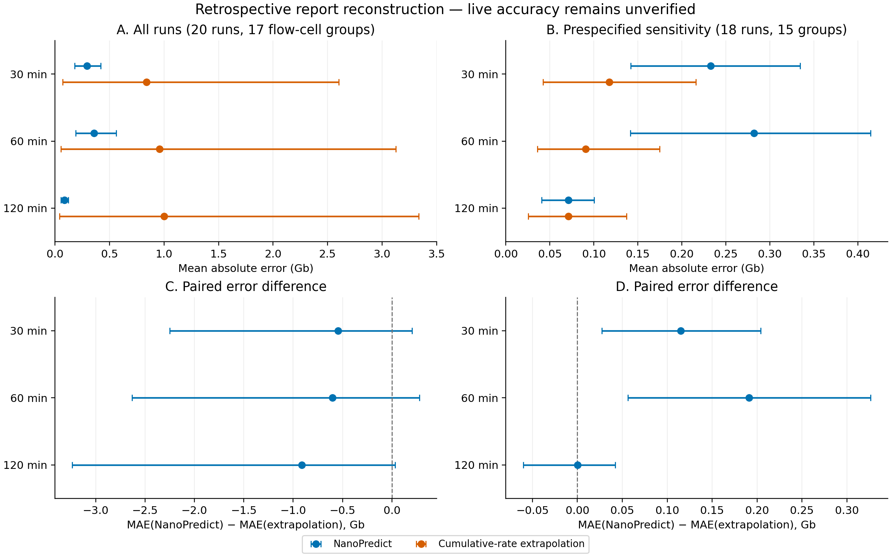

# Historical evaluation of the legacy models

Supplementary historical record, 16 October 2026. These results concern the older bundled models, trained on a mixed MinION/PromethION collection. **They do not evaluate the new MinION-only candidates.** They are retained to document training overlap and unfavorable as well as favorable comparisons. The frozen inputs, models and output tables remain unchanged.

The legacy 30- and 60-minute models use standardized raw-yield ridge regression; the 120-minute model uses 600 extra trees. Their training row counts are 198, 213 and 243. Recovered records establish 244 development acquisitions (183 MinION and 61 PromethION). Fourteen of the 20 runs below contributed to all three legacy models. Sample-label-grouped five-fold residual calibration and the original tuning did not fully account for shared flowcells.

## Original 20-run reconstruction

The retrospective reconstruction comprised 20 MinION Mk1D runs from 20 different patients, with distinct specimens and libraries according to the investigator. Although these cases were initially declared separate from development, a subsequent audit of recovered training records confirmed matching protocol and acquisition identifiers for 14 runs, present at all three training checkpoints. Of the remaining six runs, one shared a training flow cell; five had no acquisition, protocol or flow-cell match. Biological relationships still require review. The 20-run results below are retained as an overlapping retrospective demonstration, not an independent evaluation. The investigator stated that NanoPredict forecasts did not influence stopping decisions. The cases were described as randomly selected, but no formal sampling frame or consecutive recruitment was documented. Seventeen flow-cell identifiers defined related groups, including one group of two and one group of three runs.

Final passed-base totals and passed-read counts matched the corresponding sequencing summaries exactly for all 20 runs; no duplicate, missing or foreign-run read identifiers were detected. Eighteen runs completed their configured protocols and two stopped intentionally after sufficient data had been obtained. Configured limits were 3 h (eight runs), 12 h (ten), 6 h (one) and 72 h (one). The latter two were confirmed setting errors in intended 3-h workflows. The primary endpoint retained observed final yield and configured model inputs; a prespecified sensitivity analysis excluded these two cases without replacing their inputs with intended duration.

Inputs at 30, 60 and 120 minutes were reconstructed from JSON and linked HTML reports using native 10- or 30-minute bins. Explicit source timestamps constrained cumulative statistics, duty time, temperature and pore scans. Boxplot indexing followed report bucket width. These reconstructed inputs cannot establish when historical basecalls were available or reproduce the live collector’s windows. Therefore this analysis assesses the bundled predictors on report reconstruction, not contemporaneous live accuracy. No additional model fitting or recalibration occurred during retrospective scoring, but the deployed models had already used outcomes from the 14 overlapping runs. Missing recent-rate inputs affected 11 first checkpoints and were retained as missing; comparison denominators were method-specific, with paired comparisons restricted to the same runs. The analysis specification, inputs, models, scripts and environment were frozen before prediction generation. Uncertainty was estimated separately at each horizon with 2,000 flow-cell-group bootstrap replicates.

All 60 reconstructed checkpoints produced bundled-model estimates. Final passed yield ranged from 0.000064 to 1.955 Gb (median 0.269 Gb). Table S1 reports point-error estimates and paired differences. In the full cohort, all three confidence intervals for the MAE difference crossed zero. S15, mistakenly configured for 72 h and stopped at approximately 2 h 25 min, contributed 85–93% of cumulative-extrapolation absolute error across checkpoints. The prespecified sensitivity therefore materially changed the comparison.

Table S1. Retrospective reconstruction error in Gb in a cohort with 14/20 training-overlapping runs; not independent validation. Lower MAE is better. Differences are NanoPredict minus cumulative-rate extrapolation; brackets give 95% flow-cell-group bootstrap percentile intervals.

| Analysis | Checkpoint | NanoPredict MAE | Extrapolation MAE | Paired MAE difference [95% interval] |
|---|---:|---:|---:|---:|
| All 20 runs | 30 min | 0.295 | 0.841 | -0.546 [-2.250, +0.203] |
| All 20 runs | 60 min | 0.357 | 0.960 | -0.603 [-2.631, +0.279] |
| All 20 runs | 120 min | 0.088 | 1.001 | -0.913 [-3.237, +0.032] |
| Sensitivity, 18 runs | 30 min | 0.233 | 0.118 | +0.115 [+0.027, +0.204] |
| Sensitivity, 18 runs | 60 min | 0.282 | 0.091 | +0.191 [+0.056, +0.326] |
| Sensitivity, 18 runs | 120 min | 0.071 | 0.071 | +0.000 [-0.060, +0.042] |

Observed coverage of nominal 90% bundled intervals was 19/20, 19/20 and 20/20 at the three checkpoints, with mean widths of 1.271, 1.889 and 0.829 Gb. High coverage in a small selected cohort, together with these widths, does not establish calibrated uncertainty. Four runs exceeded 1 Gb; none reached 5 or 10 Gb, so the latter thresholds cannot assess performance on positive events. Recent-rate extrapolation was available for 9/20 runs at 30 minutes and all runs subsequently; all comparator, probability and interval summaries are retained in the supplementary aggregate tables.

Figure S1 shows point errors and paired differences for both the full cohort and the prespecified sensitivity analysis. Detailed feature definitions, provenance, configuration, all comparator summaries and reproduction commands are supplied with the analysis tools.

Figure S1. Retrospective reconstruction on report-native inputs. Panels A/C include all 20 runs; B/D exclude the two prespecified configuration errors. Bars show 95% percentile intervals from 2,000 flow-cell-group bootstrap replicates. Axis ranges differ between panels. Negative paired differences favor NanoPredict. Fourteen of the 20 runs overlap deployment training. These are neither independent validation nor measurements of contemporaneous live accuracy.

## Subsequent replacement-upload assessment

A subsequent descriptive assessment considered five newly supplied acquisitions after identity screening. Four acquisitions (S26–S29), representing three flow-cell groups with no training flow-cell match, formed the main subset; these cells were also represented among previously scored non-training cases. S30 shared a training flow cell and was assessed separately; S25 duplicated S4 and was not counted again. Whole-run passed-base and read totals reconciled exactly between reports and sequencing summaries. In the four-run subset, NanoPredict MAE was 0.313, 0.137 and 0.009 Gb at 30, 60 and 120 minutes, compared with 0.017, 0.015 and 0.012 Gb for cumulative-rate extrapolation. The models were unchanged. These small, selected retrospective results favor extrapolation at the early checkpoints and do not establish a general forecasting advantage or live accuracy.

Source records: [original analysis](evidence/retrospective/analysis_record.json), [paired comparisons](evidence/retrospective/paired.csv), [replacement assessment](evidence/replacement_assessment/summary.json), and [training provenance](evidence/training_provenance_recovery.json).
