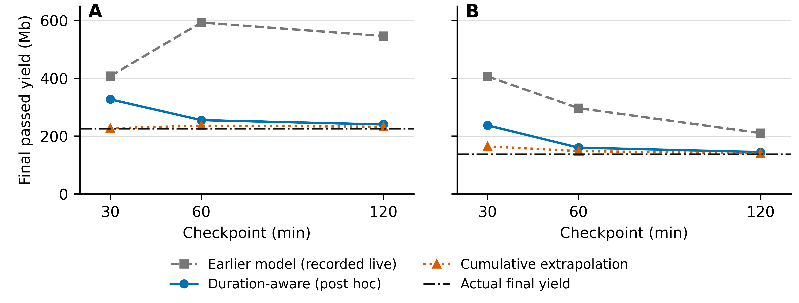

# NanoPredict: local MinION monitoring with duration-aware yield forecasts

**Draft for Bioinformatics Advances — Application Note; version 0.11.0; 23 October 2026**

Authors: Alexander Miller-Michlits, Yelyzaveta Miller-Michlits, Matthias Demetz, Christian Freyschlag, Adelheid Woehrer.

Affiliations: [AUTHOR AFFILIATIONS TO BE COMPLETED]

Corresponding author: [NAME, INSTITUTIONAL EMAIL AND POSTAL ADDRESS]

Running head: NanoPredict: duration-aware yield forecasting

## Abstract

**Motivation:** Nanopore sequencing permits continuous monitoring, but early estimates of final yield must account for the intended run duration and the statistics available during acquisition.

**Results:** NanoPredict combines local, read-only MinION monitoring, barcode progress and forecasts at 30, 60 and 120 minutes. Two live technical runs exposed overprediction by earlier models and motivated a duration-aware estimator using cumulative passed yield, elapsed observation time and configured duration. Development used 183 historical MinION acquisitions grouped by recorded sample and flowcell relationships. On 32, 33 and 33 eligible development-calibration runs, mean absolute errors were 0.298, 0.259 and 0.236 Gb, compared with 0.374, 0.371 and 0.351 Gb for cumulative-rate extrapolation. Comparisons with the previous model depended on whether errors were weighted by run or related group. Post-hoc predictions improved on earlier forecasts for both live examples, although simple extrapolation remained closer. These results describe development and technical operation; independent accuracy and probability calibration remain unvalidated.

**Availability and Implementation:** Python source and documentation are hosted at https://github.com/AlexanderM-M/nanopredict under GPL-3.0-only. Version 0.11.0 bundles the duration-aware models.

**Keywords:** nanopore sequencing; yield forecasting; real-time monitoring; MinION; bioinformatics software

## Introduction

Nanopore sequencing produces data continuously, allowing operators to follow yield while acquisition and basecalling continue. Useful monitoring must distinguish accumulated passed bases from forecasts of future production, account for delayed basecalls and relate progress to the intended sequencing duration.

NanoPack supports long-read visualization and processing (De Coster et al., 2018), pycoQC provides interactive quality control (Leger and Leonardi, 2019), BoardION supports instrument monitoring and run comparison (Bruno et al., 2021), and minoTour combines live metrics with sequence analysis and archiving (Munro et al., 2022). NanoPredict integrates local monitoring with checkpoint-based yield forecasts, uncertainty intervals, target probabilities and an auditable recording workflow. Its contribution is this integrated workflow and explicit treatment of configured duration, rather than a claim that yield estimation is new.

## Implementation

NanoPredict contains Python collectors, scikit-learn-compatible estimators (Pedregosa et al., 2011), a standard-library HTTP server and browser assets. It queries MinKNOW through read-only API calls (Oxford Nanopore Technologies, 2026); the default server binds to the loopback interface. The dashboard displays passed yield, recent production rate, barcode progress and user-defined targets. Completed-BAM monitoring remains available when essential API statistics cannot be read. Forecasts concern the whole MinION run; barcode, PromethION and BAM-fallback views provide monitoring without calibrated final-yield forecasts. The software does not control sequencing or recommend automatic stopping.

A separate recorder freezes source and model hashes, environment information, comparator settings and a protocol before enrollment. It stores checkpoint inputs and predictions durably, records missing checkpoints and rejects changes to frozen dependencies. Qualification records are distinguished from independent evaluation records. Forty numerical audit features are retained, although only three enter the current forecast. JSON and CSV dashboard exports use an explicit field allow-list. Installation, replay and collection commands are provided in Supplementary Methods.

## Duration-aware model development

Version 0.11.0 predicts passed bases at the configured endpoint from accumulated passed yield, elapsed observation time and planned duration. At each checkpoint, the estimator adds projected remaining production to observed yield, using the average passed-base rate multiplied by a fitted scale and integrated exponential decay. With no decay and unit scale, it reduces to cumulative-rate extrapolation. Predictions cannot fall below observed yield. Missing duration or invalid counters make the forecast unavailable; 72 hours is never substituted. Forecasts are checkpoint snapshots, conditional on continued sequencing towards the configured endpoint, rather than continuously updated trajectories.

The historical development collection contained 183 MinION acquisitions and 539 checkpoint rows; 115 PromethION rows were excluded. Recorded sample and flowcell relationships defined 86 groups, partitioned with seed 20261016 into 64 fitting/model-selection groups and 22 development-calibration groups. The duration-aware revision retained this partition. Requiring finite counters, positive elapsed time and duration, and a planned endpoint no earlier than the observation reduced the available rows (Table 1). No qualification run entered parameter fitting or calibration.

Fitting-only five-fold grouped cross-validation compared ten combinations of decay half-life (3, 6, 12 or 24 hours, or no decay) and fixed versus fitted scale. Scale fitting minimized group-weighted absolute error within bounds of zero to two. A candidate had to improve overall group-weighted error by at least 1% over cumulative extrapolation and worsen error by no more than 5% among runs configured for at most six hours; otherwise the cumulative baseline was retained. Selected half-lives were 6, 12 and 12 hours, with scales 1.761, 1.188 and 1.136 at 30, 60 and 120 minutes. These are fitted extrapolation parameters, not measured pore lifetimes.

Separate development-calibration groups supplied signed log1p residuals. Prediction intervals use order statistics of maximum absolute residuals within groups; target probabilities use equally weighted groups and Laplace smoothing. Both refer to the duration-dependent forecast. Detailed formulas and exclusions appear in Supplementary Methods. Historical outcomes are observed-ending final passed yield, which can include early stops; they do not establish counterfactual production at the planned endpoint.

## Results

Development-calibration run-weighted mean absolute error (MAE) was 0.298, 0.259 and 0.236 Gb at the three checkpoints (Table 1). Cumulative extrapolation and the previous 40-feature MinION models were scored on the same eligible rows. Group-weighted MAE, which gives each related group equal influence, was 0.330, 0.337 and 0.327 Gb for the new model versus 0.260, 0.266 and 0.243 Gb for the previous model. Thus, the revision did not improve every comparison. Among calibration runs configured for at most six hours, cumulative extrapolation also had lower 30-minute MAE (0.134 versus 0.205 Gb). This previously inspected development partition supports descriptive comparisons, not an independent accuracy claim.

Two completed three-hour MinION acquisitions provided technical examples. Run A used the legacy mixed-device models and produced 225.955 Mb of final passed yield; run B used the previous MinION-only models and produced 136.929 Mb. All three checkpoints were recorded for both runs. Recorded passed-base counters matched final-report checkpoint values, and final passed yield reconciled with sequencing summaries. The runs shared a flowcell and cannot be treated as independent flowcell replicates; operator blinding was not established.

The previous MinION model predicted 406.574, 296.877 and 210.390 Mb for run B. Investigation identified a sampling mismatch: live statistics used 1800-second intervals, whereas all 18 fitting acquisitions configured for three hours used 600-second intervals. Recent-rate features were missing at the first live checkpoint, and changing sampling metadata altered predictions. This diagnosis motivated excluding sampling resolution and window-local quality statistics from the new estimator; it did not establish equivalence of all live and historical features.

Applying the duration-aware models post hoc to the recorded inputs yielded 327.397, 255.272 and 240.434 Mb for run A, and 237.290, 160.186 and 144.759 Mb for run B (Figure 1). Errors were smaller than those of the models used live, but cumulative extrapolation was closer at all six checkpoints. Both runs informed model design, so these comparisons are diagnostic illustrations, not independent validation or prospective tests of version 0.11.0.

All 98 saved development-calibration predictions reproduced through the runtime consumer. The replacement source passed 103 automated tests; an extracted transfer package passed its 59 included tests. Replay processed all 513 packaged snapshots: 480 produced forecasts and 33 with missing required inputs remained explicitly unavailable. These checks support software consistency, not predictive accuracy or broad hardware reliability. Earlier legacy-model retrospective results, including a 20-run analysis with 14 training-overlapping acquisitions, are retained separately in Supplementary Historical Results.

## Discussion

NanoPredict makes the configured sequencing duration an explicit forecast input and separates observed progress from projected yield. The live examples demonstrate why software qualification matters: sampling and missingness patterns can change between historical reports and an operational API, even when model files load correctly. The revised estimator removes those particular dependencies and preserves the inputs needed to audit its forecasts.

The evidence remains limited by previously inspected development data, incomplete biological relationship records and outcomes affected by stopping decisions. Lower run-weighted development error coexists with higher group-weighted error than the previous model. Simple extrapolation remains a necessary comparator, particularly for short runs. Neither nominal interval coverage nor displayed target probabilities have been validated on independent runs, and promotion to package defaults does not establish such validation.

Further assessment should freeze the current artifacts before evaluating new eligible acquisitions, retain contemporaneous input availability and end reasons, and compare methods on identical runs with uncertainty calculated across related groups. Retrospective reconstruction and live recording answer different questions. The present contribution is a local monitoring and recording workflow with a reproducible duration-aware development model and documented operational examples.

## Data and software availability

Source code and documentation are hosted at https://github.com/AlexanderM-M/nanopredict under GPL-3.0-only. The accompanying supplementary files provide aggregate development results, model hashes, figure data and reproduction commands; the packaged anonymous replay data demonstrate software behavior and overlap development data. Original reports and identifiers remain outside the public package. [AUTHOR TO CONFIRM PERMITTED DATA ACCESS AND THE PUBLIC ARCHIVE IDENTIFIER FOR THE EXACT VERSION 0.11.0 SOURCE AND MODELS.]

## Ethics and author contributions

Ethics approval reference: N1115/2026. [ETHICS COMMITTEE NAME, APPROVED SCOPE AND CONSENT OR WAIVER BASIS TO BE CONFIRMED.]

[AUTHOR CONTRIBUTIONS TO BE CONFIRMED.]

## Acknowledgements and funding

[FUNDING SOURCES AND GRANT NUMBERS, OR CONFIRMED ABSENCE OF SPECIFIC FUNDING.]

AI assistance was used for repository review, analysis-code development and manuscript drafting. The authors are responsible for checking the analyses, references and final text. [AUTHOR VERIFICATION AND APPROVAL PENDING.]

Conflict of interest: none declared.

## Tables and figures

Table 1. Development-calibration MAE in Gb (10^9 passed bases), weighted equally by run. Each comparison uses the same eligible calibration acquisitions at its checkpoint. Fitting/calibration counts are acquisitions, not independent biological samples. “Previous” denotes the 16 October MinION-only ridge/tree models, not the legacy mixed-device models. These are development results, not independent validation.

| Checkpoint (min) | Fitting / calibration | Duration-aware | Cumulative | Previous |
|---|---:|---:|---:|---:|
| 30 | 133 / 32 | 0.298 | 0.374 | 0.438 |
| 60 | 134 / 33 | 0.259 | 0.371 | 0.327 |
| 120 | 134 / 33 | 0.236 | 0.351 | 0.387 |

{width=6.7in}

Figure 1. Recorded and post-hoc forecasts for two three-hour technical runs sharing a flowcell. Panels A and B correspond to the legacy-model and previous MinION-model acquisitions, respectively. Points show forecasts of final passed yield at the 30-, 60- and 120-minute checkpoints; horizontal lines show reconciled final outcomes. The duration-aware estimates were calculated after these outcomes were known and used in model design. Cumulative extrapolation was closer to the outcome than the new model at every checkpoint. No independence, blinding or prospective validation of the new model is implied. Exact values are supplied in Supplementary Table S4 and the figure-data CSV.

Alt text: Two plots compare forecasts against final passed yields of 225.955 and 136.929 Mb. Earlier models overpredict. Duration-aware estimates approach the outcomes at later checkpoints, but cumulative extrapolation is closest throughout.

## References

Bruno, A., Aury, J.-M. and Engelen, S. (2021) BoardION: real-time monitoring of Oxford Nanopore sequencing instruments. *BMC Bioinformatics*, **22**, 245. [doi:10.1186/s12859-021-04161-0](https://doi.org/10.1186/s12859-021-04161-0).

De Coster, W., D’Hert, S., Schultz, D.T., Cruts, M. and Van Broeckhoven, C. (2018) NanoPack: visualizing and processing long-read sequencing data. *Bioinformatics*, **34**, 2666–2669. [doi:10.1093/bioinformatics/bty149](https://doi.org/10.1093/bioinformatics/bty149).

Leger, A. and Leonardi, T. (2019) pycoQC, interactive quality control for Oxford Nanopore Sequencing. *Journal of Open Source Software*, **4**, 1236. [doi:10.21105/joss.01236](https://doi.org/10.21105/joss.01236).

Munro, R. et al. (2022) minoTour, real-time monitoring and analysis for nanopore sequencers. *Bioinformatics*, **38**, 1133–1135. [doi:10.1093/bioinformatics/btab780](https://doi.org/10.1093/bioinformatics/btab780). Published online 15 November 2021.

Oxford Nanopore Technologies (2026) MinKNOW API: protobuf and gRPC specifications. [Source and documentation](https://github.com/nanoporetech/minknow_api). Accessed 15 October 2026; analysis client version 6.10.3.

Pedregosa, F. et al. (2011) Scikit-learn: Machine Learning in Python. *Journal of Machine Learning Research*, **12**, 2825–2830. [Article](https://jmlr.org/papers/v12/pedregosa11a.html).
